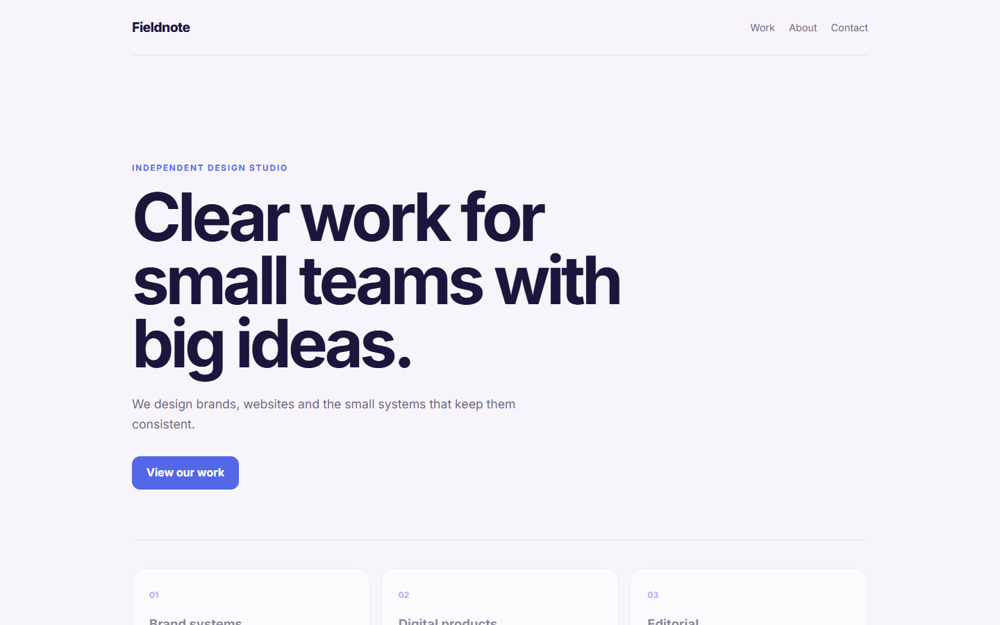

# showcase-capture

Capture screenshots, a captioned GIF and a WebM tour of a web project from a YAML or TypeScript config.

It is built as an agent skill and a small CLI. The skill tells an agent how to inspect a project, write the config and review the output. The CLI does the capture.



## Install

```bash
npm install
npm run build
npx playwright install chromium
```

Once published, from the npm package:

```bash
npx showcase-capture install
```

Check the environment:

```bash
npx showcase-capture doctor
```

## Quick start

```bash
npx showcase-capture init
npx showcase-capture check
npx showcase-capture capture
```

`init` creates `showcase.config.yaml` and `docs/showcase/screens/`.

## Commands

```bash
showcase-capture init
showcase-capture check [--config <file>] [--only <scene>]
showcase-capture capture [--config <file>] [--only <scene>] [--out <dir>]
showcase-capture doctor
showcase-capture install
```

Options:

- `--config <file>`: YAML, TypeScript, JavaScript or MJS config.
- `--only <scene>`: run one scene.
- `--skip-gif`: skip GIF and video.
- `--skip-video`: capture the GIF but not WebM.
- `--headed`: show the browser.
- `--base-url <url>`: override the server URL.
- `--out <dir>`: override the output directory.

## Output

- `screens/*.png`
- `README.md`
- `index.html`
- `showcase.json`
- optional `*.gif`
- optional `*.webm`

The README and gallery are generated from the manifest. The gallery is a single static HTML file and works on GitHub Pages.

## Config

The default config is YAML. TypeScript is available for custom logic.

```yaml
name: My project
outDir: docs/showcase

server:
  mode: static
  dir: dist
  spa: true

reset:
  localStorage:
    - my-app.demo.v1

viewports:
  desktop: { width: 1440, height: 900 }
  mobile: { width: 390, height: 844 }

scenes:
  - name: desktop
    viewport: desktop
    steps:
      - goto: /
      - waitFor: h1
      - screenshot: 01-home

gif:
  steps:
    - goto: /
    - caption: [1, "Home", "A short tour"]
    - wait: 600

video:
  enabled: true
```

See [SKILL.md](SKILL.md) for the full step reference, server modes and troubleshooting.

## Static sites

```yaml
build: npm run build
server:
  mode: static
  dir: dist
  spa: true
```

The CLI starts a local static server, serves the directory, and captures the scenes.

## Examples

YAML config:

```bash
node dist/cli.js capture --config examples/static-site/showcase.config.yaml
```

TypeScript config with a custom `run` step:

```bash
node dist/cli.js check --config examples/typescript-config/showcase.config.ts
```

Generated example output:

- `examples/static-site/docs/showcase/index.html`
- `examples/static-site/docs/showcase/README.md`
- `examples/static-site/docs/showcase/fieldnote-studio.gif`
- `examples/static-site/docs/showcase/fieldnote-studio.webm`

## License

MIT. See [LICENSE](LICENSE).
